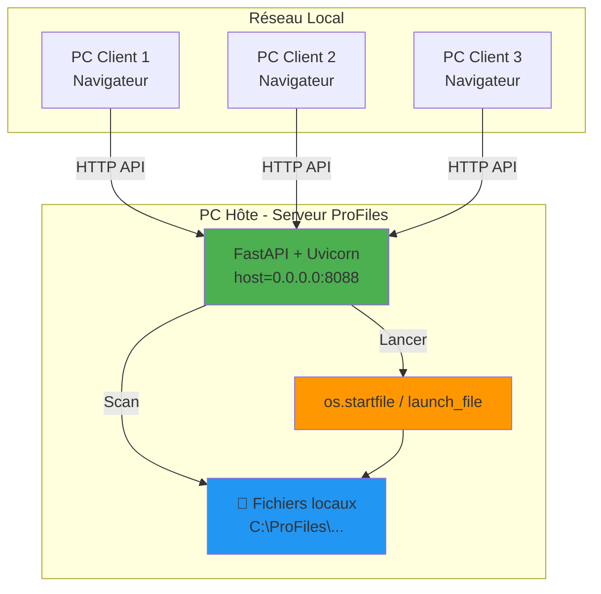

# ProFiles Network Server Design

**Date**: 2026-10-15  
**Feature**: Réseau local - Mode serveur accessible depuis d'autres PC  
**Approche**: Option A - Simple network exposure (0.0.0.0)  
**Status**: Design approved, ready for implementation

---

## 🎯 Objectif

Rendre l'interface web ProFiles accessible depuis d'autres PC du réseau local, permettant le lancement de fichiers hébergés sur le PC hôte.

---

## 📐 Architecture

### Architecture Cible



### Composants

| Composant | Rôle | Localisation |
|-----------|------|--------------|
| **Uvicorn Server** | Serveur HTTP ASGI | `src/profiles/desktop/lifecycle.py` |
| **FastAPI App** | API REST + Web UI | `src/profiles/server/app.py` |
| **Web UI** | Interface React | `src/profiles/web/dist/` |
| **File Launcher** | Lancement fichiers | `src/profiles/core/actions.py` |

---

## 🔧 Spécifications Techniques

### 1. Configuration du Serveur

#### Changement d'adresse d'écoute

**Fichier**: `src/profiles/desktop/lifecycle.py`

```python
class BackgroundServer:
    def __init__(self, config: AppConfig, host: str = "0.0.0.0", port: int = 8088) -> None:
        self.host = host  # Change: "127.0.0.1" → "0.0.0.0"
        self.port = port if port != 0 else find_available_port(8088)
```

**Impact**: Le serveur écoute sur toutes les interfaces réseau (LAN, WiFi, Ethernet).

#### Paramètre de lancement

**Fichier**: `src/profiles/app.py`

```python
def _run_server_only(self, port: int = _DEFAULT_PORT, host: str = "0.0.0.0") -> None:
    """Run only the FastAPI background server without opening PyWebView."""
    server = BackgroundServer(config=self._config, host=host, port=port)
    # ...
    print(f"ProFiles server running at http://{host}:{server.port} (press Ctrl+C to stop)")
```

**Note**: Pour afficher l'IP réelle, utiliser `get_local_ip()` au lieu de `host`.

### 2. Affichage de l'IP Réseau

**Fichier**: `src/profiles/utils/network.py`

Ajouter une fonction pour obtenir l'IP locale :

```python
def get_local_ip() -> str:
    """Get the local IP address of the machine.
    
    Returns:
        Local IP address (e.g., 192.168.1.100) or 'localhost' if unavailable.
    """
    import socket
    
    try:
        # Create a socket to determine the outbound interface IP
        with socket.socket(socket.AF_INET, socket.SOCK_DGRAM) as s:
            s.connect(("8.8.8.8", 80))
            ip = s.getsockname()[0]
        return ip
    except Exception:
        return "127.0.0.1"
```

**Usage dans le message de démarrage** :

```python
# src/profiles/app.py - _run_server_only
from profiles.utils.network import get_local_ip


def _run_server_only(self, port: int = _DEFAULT_PORT, host: str = "0.0.0.0") -> None:
    # ...
    local_ip = get_local_ip()
    print(f"ProFiles server running at:")
    print(f"  Local:  http://127.0.0.1:{port}")
    print(f"  Network: http://{local_ip}:{port}")
    print(f"  Access from other PCs on your network")
```

### 3. Sécurité et Firewall

#### Firewall Windows

**Commande manuelle** (à exécuter une fois) :

```powershell
New-NetFirewallRule -DisplayName "ProFiles Server" -Direction Inbound -Protocol TCP -LocalPort 8088 -Action Allow
```

**Alternative via GUI** :
1. Panneau de configuration → Pare-feu Windows
2. Autoriser une application
3. Ajouter "ProFiles" ou port 8088 TCP

#### Sécurité Réseau

**Niveau actuel** : Réseau de confiance (pas d'authentification)

**Protection** :
- ✅ Firewall Windows par défaut bloque les connexions entrantes
- ✅ Règle explicite requise pour port 8088
- ✅ Réseau LAN isolé (pas d'exposition Internet)
- ⚠️ **NE PAS** configurer de port forwarding sur le routeur

### 4. UX Clients

#### Accès depuis un PC Client

1. **URL**: `http://<IP-HOTE>:8088`
   - Exemple: `http://192.168.1.100:8088`

2. **Interface** : Identique au desktop (React + Vite)

3. **Fonctionnalités** :
   - ✅ Scan des fichiers (via API `/api/fs/scan`)
   - ✅ Filtrage par extension
   - ✅ Lancement de fichiers (via API `/api/actions/launch`)
   - ✅ Sélection de répertoire
   - ✅ Chargement de configs

4. **Limitations** :
   - ⚠️ Les fichiers sont lancés sur le PC Hôte, pas sur le client
   - ⚠️ Nécessite que les fichiers existent sur le PC Hôte

---

## 📋 Fichiers à Modifier

### Modifications Minimales

| Fichier | Ligne | Modification | Type |
|---------|-------|--------------|------|
| `src/profiles/desktop/lifecycle.py` | 52 | `host: str = "0.0.0.0"` | Default param |
| `src/profiles/app.py` | 261 | `host: str = "0.0.0.0"` | Default param |
| `src/profiles/app.py` | 275 | Message d'affichage IP | UX improvement |
| `src/profiles/utils/network.py` | +20 | `get_local_ip()` function | New feature |

### Fichiers à Créer

| Fichier | Type | Contenu |
|---------|------|---------|
| `docs/superpowers/specs/2026-10-15-network-server-guide.md` | Guide | Documentation utilisateur |

---

## 🧪 Stratégie de Test

### Scénarios de Test

#### Test 1: Démarrage Serveur

```powershell
# PC Hôte
ProFiles --server-only

# Attendu:
# ProFiles server running at:
#   Local:  http://127.0.0.1:8088
#   Network: http://192.168.1.100:8088
#   Access from other PCs on your network
```

#### Test 2: Accès Local

```powershell
# PC Hôte - navigateur
http://127.0.0.1:8088

# Attendu: Interface web chargée
```

#### Test 3: Accès Réseau

```powershell
# PC Client - navigateur
http://192.168.1.100:8088

# Attendu: Interface web chargée
```

#### Test 4: Scan Fichiers

```
# PC Client - clic sur "Scan"
# Attendu: Liste des fichiers affichée (via API PC Hôte)
```

#### Test 5: Lancement Fichier

```
# PC Client - clic sur fichier
# Attendu: Fichier lancé sur PC Hôte (pas sur client)
```

### Validation Firewall

```powershell
# Vérifier la règle firewall
Get-NetFirewallRule -DisplayName "ProFiles Server"

# Tester la connectivité depuis un client
Test-NetConnection -ComputerName 192.168.1.100 -Port 8088
```

---

## ⚠️ Points d'Attention

### Sécurité

- ⚠️ **Ne pas exposer sur Internet** (pas de port forwarding NAT)
- ⚠️ **Réseau de confiance uniquement** (pas de WiFi public)
- ⚠️ **Firewall obligatoire** (Windows Defender ou équivalent)
- ⚠️ **Pas d'authentification** (à ajouter si besoin de sécurité renforcée)

### Réseau

- ⚠️ **IP statique recommandée** pour le PC Hôte (DHCP reservation)
- ⚠️ **Port 8088 libre** sur tous les clients
- ⚠️ **Sous-réseau identique** (192.168.1.x / 255.255.255.0)
- ⚠️ **Groupes de travail** : Même groupe réseau pour tous les PC

### Performance

- ✅ Scan fichiers : local (rapide)
- ✅ Lancement fichiers : instantané
- ⚠️ Nombre de fichiers : < 10k recommandé
- ⚠️ Latence réseau : < 50ms idéale

---

## 🚀 Workflow de Déploiement

### PC Hôte

1. **Installer ProFiles** (si pas déjà fait)
   ```powershell
   pip install -e ".[dev]"
   ```

2. **Configurer Firewall** (une fois)
   ```powershell
   New-NetFirewallRule -DisplayName "ProFiles Server" -Direction Inbound -Protocol TCP -LocalPort 8088 -Action Allow
   ```

3. **Démarrer le serveur**
   ```powershell
   ProFiles --server-only
   ```

4. **Noter l'IP affichée**
   ```
   Network: http://192.168.1.100:8088
   ```

### PC Clients

1. **Ouvrir le navigateur**

2. **Accéder à l'URL**
   ```
   http://192.168.1.100:8088
   ```

3. **Utiliser l'interface** comme sur le desktop

---

## 📈 Évolutions Futures

### Option B: Authentification

- Token d'accès ou authentification basique
- +200-300 lignes de code
- Sécurité renforcée

### Option C: Discovery Auto

- mDNS/Bonjour pour découverte automatique
- Pas de configuration IP manuelle
- Dépendance `zeroconf`

### Option D: HTTPS

- Certificat auto-signé ou Let's Encrypt
- Chiffrement des communications
- Configuration plus complexe

---

## ✅ Checklist de Validation

### Code

- [ ] `host` changé vers `0.0.0.0` dans `lifecycle.py`
- [ ] `host` changé vers `0.0.0.0` dans `app.py`
- [ ] Fonction `get_local_ip()` ajoutée
- [ ] Message de démarrage amélioré
- [ ] Tests unitaires mis à jour (si nécessaire)

### Sécurité

- [ ] Firewall configuré
- [ ] Documentation sécurité ajoutée
- [ ] Avertissements réseau clairs

### UX

- [ ] IP réseau affichée au démarrage
- [ ] Instructions d'accès documentées
- [ ] Guide utilisateur créé

### Tests

- [ ] Serveur démarre sur `0.0.0.0`
- [ ] Accès local fonctionne (127.0.0.1)
- [ ] Accès réseau fonctionne (IP locale)
- [ ] Scan fichiers fonctionne
- [ ] Lancement fichiers fonctionne
- [ ] Logs montrent IP client

---

## 📚 Références

- [Uvicorn Configuration](https://www.uvicorn.org/config/)
- [FastAPI Background Tasks](https://fastapi.tiangolo.com/tutorial/background-tasks/)
- [Windows Firewall PowerShell](https://docs.microsoft.com/en-us/powershell/module/netsecurity/new-netfirewallrule)
- [Python socket.getsockname](https://docs.python.org/3/library/socket.html#socket.socket.getsockname)

---

**Approbation Design** : ✅ Validé par l'utilisateur  
**Prochaine étape** : Invocation de `writing-plans` pour créer le plan d'implémentation
