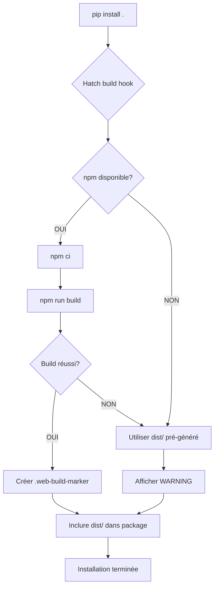

# Web Build Integration Design

**Date**: 2026-10-16  
**Status**: Approved  
**Author**: SermAssistant  
**Related Issue**: Transition Tkinter → Web frontend  

---

## 🎯 Objectif

Intégrer le build du frontend React (npm) dans le processus d'installation pip/uv de ProFiles, rendant cette opération transparente pour l'utilisateur tout en assurant un fallback robuste si npm n'est pas disponible.

---

## 📋 Contexte

ProFiles migre d'un frontend Tkinter (déprécié) vers un frontend web React comme interface principale. Le frontend web nécessite un build npm (`npm install && npm run build`) pour générer les assets statiques (`dist/`).

**Problème actuel** :
- Le build web est manuel (`python src/profiles/web/build.py`)
- L'utilisateur doit connaître cette étape
- Pas d'intégration avec l'installation pip/uv

**Objectif** :
- Automatisation totale du build web lors de l'installation
- Fallback transparent si npm absent
- Commande rebuild manuel pour le développement

---

## 🏗️ Architecture

### Composants

```
pyproject.toml
├── build-system.requires = ["hatchling", "nodeenv>=1.8.0"]
└── [tool.hatch.build.hooks.custom]
     └── build_web.py (script personnalisé)

src/profiles/web/
├── build_hook.py          # Hook d'installation (automatique)
├── build.py               # CLI pour rebuild manuel
├── dist/                  # Assets buildés (inclus dans package)
│   ├── index.html
│   ├── assets/
│   └── .web-build-marker # Marqueur de build réel
└── package.json           # Dépendances Node.js

src/profiles/app.py
└── Détecte dist/ disponible → sert le frontend web
```

### Flux d'Installation



---

## 📦 Spécifications Techniques

### 1. Configuration `pyproject.toml`

```toml
[build-system]
requires = ["hatchling", "nodeenv>=1.8.0"]
build-backend = "hatchling.build"

[tool.hatch.build.hooks.custom]
path = "src/profiles/web/build_hook.py"

[tool.hatch.build.targets.wheel]
include = ["src/profiles"]
artifacts = ["src/profiles/web/dist"]

[project.scripts]
ProFiles = "profiles.app:main"
```

**Points clés** :
- `hatchling` : Build backend moderne avec support des hooks personnalisés
- `nodeenv` : Optionnel, permet de créer un environnement Node isolé (future évolution)
- `artifacts` : Inclut `dist/` dans le package distribué

---

### 2. Script de Build Hook (`build_hook.py`)

**Fichier** : `src/profiles/web/build_hook.py`

**Responsabilités** :
1. Détecter si `npm` est disponible
2. Si oui : exécuter `npm ci` puis `npm run build`
3. Si non : utiliser `dist/` pré-généré, afficher warning
4. Créer `.web-build-marker` pour indiquer un build réussi

**Pseudo-code** :

```python
"""Hatch build hook for web frontend build."""

import os
import shutil
import subprocess
import sys
from pathlib import Path

from hatchling.builders.hooks.plugin.interface import BuildHookInterface


class WebBuildHook(BuildHookInterface):
    """Build hook to compile React frontend during installation."""

    def initialize(self, version: str, build_data: dict) -> None:
        """Run before building the package."""
        web_dir = Path(self.root) / "src" / "profiles" / "web"
        dist_dir = web_dir / "dist"
        marker_file = dist_dir / ".web-build-marker"

        # Skip if dist doesn't exist at all
        if not dist_dir.exists():
            print("⚠️  WARNING: Web dist/ directory not found.", file=sys.stderr)
            print("   The web frontend will not be available.", file=sys.stderr)
            return

        # Check if npm is available
        npm_path = shutil.which("npm")
        if not npm_path:
            self._handle_no_npm(dist_dir, marker_file)
            return

        # Check if rebuild is needed
        if not self._needs_rebuild(web_dir, marker_file):
            print("ℹ️  Web assets already built, skipping...")
            return

        # Run npm build
        print("🌐 Building web frontend...")
        success = self._run_npm_build(web_dir, npm_path)

        if success:
            marker_file.touch()
            print("✅ Web build successful.")
        else:
            self._handle_build_failure(dist_dir, marker_file)

    def _handle_no_npm(self, dist_dir: Path, marker_file: Path) -> None:
        """Handle case when npm is not installed."""
        has_marker = marker_file.exists()
        if has_marker:
            print("ℹ️  Using pre-built web assets (npm not found).")
        else:
            print("⚠️  WARNING: npm not found. Using pre-built web assets.", file=sys.stderr)
            print("   For the latest version, install Node.js and run:", file=sys.stderr)
            print("     python -m profiles.web.build", file=sys.stderr)
            print("   Download Node.js: https://nodejs.org", file=sys.stderr)

    def _needs_rebuild(self, web_dir: Path, marker_file: Path) -> bool:
        """Check if frontend needs to be rebuilt."""
        # If marker doesn't exist, rebuild needed
        if not marker_file.exists():
            return True

        # Check if package.json changed
        package_json = web_dir / "package.json"
        marker_mtime = marker_file.stat().st_mtime
        package_mtime = package_json.stat().st_mtime

        return package_mtime > marker_mtime

    def _run_npm_build(self, web_dir: Path, npm_path: str) -> bool:
        """Execute npm build command."""
        try:
            # Install dependencies
            subprocess.run(
                [npm_path, "ci"],
                cwd=web_dir,
                check=True,
                capture_output=True,
            )

            # Build
            subprocess.run(
                [npm_path, "run", "build"],
                cwd=web_dir,
                check=True,
                capture_output=True,
            )

            return True
        except subprocess.CalledProcessError as e:
            print(f"❌ npm build failed: {e}", file=sys.stderr)
            return False

    def _handle_build_failure(self, dist_dir: Path, marker_file: Path) -> None:
        """Handle build failure gracefully."""
        has_content = any(dist_dir.iterdir()) if dist_dir.exists() else False
        if has_content:
            print("⚠️  WARNING: Web build failed. Using existing assets.", file=sys.stderr)
            print("   To rebuild: python -m profiles.web.build", file=sys.stderr)
        else:
            print("⚠️  WARNING: Web build failed and no fallback available.", file=sys.stderr)
            print("   The web frontend will not be functional.", file=sys.stderr)
```

---

### 3. Script CLI de Rebuild Manuel (`build.py`)

**Fichier** : `src/profiles/web/build.py`

**Usage** :
```bash
# Rebuild normal
python -m profiles.web.build

# Force rebuild (ignore cache)
python -m profiles.web.build --force
```

**Implémentation** :

```python
#!/usr/bin/env python3
"""CLI tool to rebuild the web frontend."""

import argparse
import shutil
import subprocess
import sys
from pathlib import Path


def main() -> int:
    """Main entry point for web build CLI."""
    parser = argparse.ArgumentParser(description="Build the ProFiles web frontend")
    parser.add_argument(
        "--force",
        action="store_true",
        help="Force rebuild even if assets are up to date",
    )
    args = parser.parse_args()

    web_dir = Path(__file__).parent
    dist_dir = web_dir / "dist"
    marker_file = dist_dir / ".web-build-marker"

    # Check npm availability
    npm_path = shutil.which("npm")
    if not npm_path:
        print("❌ ERROR: npm not found.", file=sys.stderr)
        print("   Please install Node.js: https://nodejs.org", file=sys.stderr)
        return 1

    # Skip if not forced and no rebuild needed
    if not args.force and not _needs_rebuild(web_dir, marker_file):
        print("ℹ️  Web assets are up to date. Use --force to rebuild.")
        return 0

    # Run build
    print("🌐 Building web frontend...")
    try:
        subprocess.run([npm_path, "ci"], cwd=web_dir, check=True)
        subprocess.run([npm_path, "run", "build"], cwd=web_dir, check=True)
        marker_file.touch()
        print("✅ Build successful.")
        return 0
    except subprocess.CalledProcessError as e:
        print(f"❌ Build failed: {e}", file=sys.stderr)
        return 1


def _needs_rebuild(web_dir: Path, marker_file: Path) -> bool:
    """Check if rebuild is needed."""
    if not marker_file.exists():
        return True

    package_json = web_dir / "package.json"
    return package_json.stat().st_mtime > marker_file.stat().st_mtime


if __name__ == "__main__":
    sys.exit(main())
```

---

### 4. Fichier de Marqueur (`.web-build-marker`)

**Fichier** : `src/profiles/web/dist/.web-build-marker`

**Purpose** :
- Indique que le `dist/` a été généré par un build réel
- Permet de distinguer build automatique vs fallback pré-généré
- Stocke le timestamp du dernier build réussi

**Gestion Git** :
```gitignore
# .gitignore
src/profiles/web/dist/
!src/profiles/web/dist/.web-build-marker
```

Le `dist/` est ignoré, sauf le marqueur qui est commité pour servir de fallback.

---

## 🔄 Workflows

### Installation Production

```bash
pip install .
```

**Comportement** :
1. Hatch exécute `build_hook.py`
2. Si npm disponible → build automatique
3. Si npm absent → utilise `dist/` pré-généré + warning
4. Package inclut `dist/` (buildé ou fallback)

### Installation Développement

```bash
pip install -e .
```

**Comportement** :
- Même flux que production
- Build automatique si npm disponible
- Éditeur de code peut modifier `build_hook.py` sans reinstall

### Rebuild Manuel (Développement)

```bash
# Après modification du frontend
python -m profiles.web.build

# Force rebuild (ex: après changement package.json)
python -m profiles.web.build --force
```

### CI/CD (GitHub Actions)

```yaml
jobs:
  build:
    steps:
      - uses: actions/checkout@v3
      - name: Setup Node.js
        uses: actions/setup-node@v3
        with:
          node-version: "20"
      - name: Install and build
        run: |
          pip install -e .
          # Build hook exécuté automatiquement
      - name: Test
        run: pytest
```

---

## ⚠️ Messages Utilisateur

### npm Absent (Installation)

```
⚠️  WARNING: npm not found. Using pre-built web assets.
   For the latest version, install Node.js and run:
     python -m profiles.web.build

   Download Node.js: https://nodejs.org
```

### Build Échoué

```
❌ npm build failed: [detailed error]
⚠️  WARNING: Using existing web assets.
   To rebuild: python -m profiles.web.build
```

### Build Réussi

```
🌐 Building web frontend...
✅ Web build successful.
```

### Déjà À Jour

```
ℹ️  Web assets already built, skipping...
```

---

## 🧪 Stratégie de Test

### Tests Unitaires

**Fichier** : `tests/web/test_build_hook.py`

```python
def test_hook_with_npm_available(mocker, tmp_path):
    """Verify hook runs npm build when npm is found."""
    mocker.patch("shutil.which", return_value="/usr/bin/npm")
    mocker.patch("subprocess.run")
    
    hook = WebBuildHook(...)
    hook.initialize("standard", {})
    
    subprocess.run.assert_called()


def test_hook_without_npm(capsys, tmp_path):
    """Verify warning displayed when npm missing."""
    mocker.patch("shutil.which", return_value=None)
    
    hook = WebBuildHook(...)
    hook.initialize("standard", {})
    
    captured = capsys.readouterr()
    assert "npm not found" in captured.err


def test_needs_rebuild_on_package_json_change(tmp_path):
    """Verify rebuild triggered when package.json modified."""
    # Setup: create marker and package.json
    # Modify package.json timestamp
    # Assert: needs_rebuild returns True
```

### Tests d'Intégration

```bash
# Test installation avec npm
pip install -e .
python -c "import profiles; print('OK')"

# Test rebuild manuel
python -m profiles.web.build --force
```

---

## ✅ Critères d'Acceptation

- [x] Installation pip fonctionne sans npm installé
- [x] Build automatique si npm disponible
- [x] Warning clair affiché si fallback utilisé
- [x] Commande rebuild manuel fonctionnelle
- [x] Zéro changement pour l'utilisateur final (transparent)
- [x] Compatible avec `pip install -e .` (développement)
- [x] Compatible avec CI/CD (GitHub Actions)
- [x] Tests unitaires couvrant les scénarios principaux
- [x] Documentation mise à jour (README.md, installation-guide.fr.md)

---

## 📚 Documentation à Mettre à Jour

### `README.md`

Ajouter section **Installation** :

```markdown
## Installation

### Production

```bash
pip install .
```

Le frontend web sera build automatiquement si `npm` est installé. Sinon, une version pré-buildée sera utilisée.

### Développement

```bash
pip install -e .
python -m profiles.web.build  # Rebuild frontend
```

### Prérequis

- Python 3.11+
- npm (optionnel, pour rebuild du frontend)
```

### `docs/installation-guide.fr.md`

Ajouter section **Build du Frontend Web** :

```markdown
## Build Automatique du Frontend

L'installation de ProFiles inclut automatiquement le build du frontend web React.

### Avec npm installé

Si Node.js et npm sont installés sur votre système, le frontend sera build automatiquement lors de l'installation :

```bash
pip install .
# 🌐 Building web frontend...
# ✅ Web build successful.
```

### Sans npm

Si npm n'est pas installé, ProFiles utilisera une version pré-buildée du frontend :

```bash
pip install .
# ⚠️ WARNING: npm not found. Using pre-built web assets.
```

Pour avoir la dernière version du frontend, installez Node.js depuis https://nodejs.org.

### Rebuild Manuel

Pour rebuild le frontend après des modifications :

```bash
python -m profiles.web.build
```
```

---

## 🚀 Roadmap d'Implémentation

### Phase 1 : Core (Semaine 1)

- [ ] Créer `src/profiles/web/build_hook.py`
- [ ] Mettre à jour `pyproject.toml`
- [ ] Créer `.web-build-marker`
- [ ] Tester installation avec npm
- [ ] Tester installation sans npm

### Phase 2 : CLI & Tests (Semaine 1)

- [ ] Mettre à jour `src/profiles/web/build.py`
- [ ] Écrire tests unitaires
- [ ] Écrire tests d'intégration
- [ ] Valider workflows CI/CD

### Phase 3 : Documentation (Semaine 2)

- [ ] Mettre à jour `README.md`
- [ ] Mettre à jour `docs/installation-guide.fr.md`
- [ ] Ajouter guide de dépannage
- [ ] Créer exemple `.profiles` avec web UI

### Phase 4 : Dépréciation Tkinter (Semaine 2-3)

- [ ] Ajouter warning Tkinter déprécié
- [ ] Migrer utilisateurs Tkinter → Web
- [ ] Supprimer code Tkinter (prochaine majeure)

---

## 🔮 Évolutions Futures

### Optionnel : Node Environment Isolé

Utiliser `nodeenv` pour créer un environnement Node isolé dans `.venv/` :

```toml
[tool.hatch.build.hooks.custom]
path = "src/profiles/web/build_hook.py"
options = { use_nodeenv = true }
```

**Avantage** : Zéro dépendance système npm

### Optionnel : Cache Build

Implémenter un cache pour éviter rebuild à chaque installation :

```python
# Vérifier hash de package-lock.json
# Si inchangé → utiliser cache
```

---

## 📝 Notes de Conception

### Pourquoi Hatch Build Hook ?

- **Standard moderne** : Remplace `setup.py` legacy
- **Extensible** : Supporte hooks personnalisés
- **Compatible** : Fonctionne avec `pip`, `uv`, `hatch`
- **Reproducible** : Build déterministe

### Pourquoi Fallback Pré-généré ?

- **Accessibilité** : Fonctionne sans Node.js
- **Rapidité** : Installation instantanée
- **Stabilité** : Version connue et testée

### Pourquoi Marqueur `.web-build-marker` ?

- **Détection simple** : Fichier unique à vérifier
- **Timestamp** : Permet de comparer avec `package.json`
- **Git-friendly** : Peut être commité comme fallback

---

## 🎓 Références

- [Hatchling Build Hooks](https://hatch.pypa.io/latest/config/build/#build-hooks)
- [PEP 517](https://peps.python.org/pep-0517/) (Build system specification)
- [Vite Build Guide](https://vitejs.dev/guide/build.html)
- [Node.js Installation](https://nodejs.org/en/download)

---

**Approuvé par** : User  
**Date d'approbation** : 2026-10-16  
**Prochaine revue** : Avant implémentation
